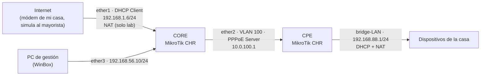
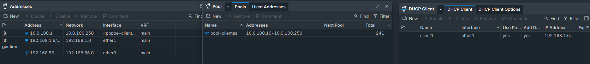
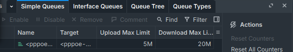
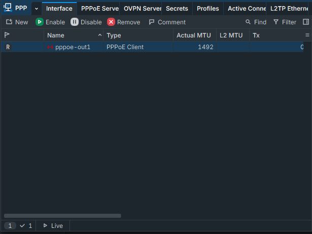
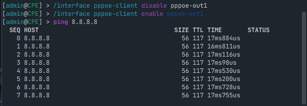

# Laboratorio Mini ISP v1.0: arquitectura de red con MikroTik (RouterOS v7)

Laboratorio armado en VirtualBox con dos routers MikroTik CHR (RouterOS 7.23.7) que simula, en chiquito, cómo está armada la red de un ISP local: un nodo central (CORE) y el router de un cliente (CPE), unidos por una VLAN con PPPoE, con límite de velocidad por plan y NAT en la casa del abonado.

Es el primer proyecto de una serie que voy a ir subiendo mientras preparo CCNA (ITN) y MTCNA de MikroTik.

## Por qué lo armé

Soy técnico en redes y estoy estudiando para CCNA y MTCNA. Mientras avanzaba con la teoría sentía que me faltaba bajarla a tierra: uno lee sobre cabeceras de Capa 2 y Capa 3, subredes, VLANs, túneles o NAT, pero hasta que no levantás los equipos y ves cómo viajan los paquetes de punta a punta, cuesta imaginárselo.

No quise aprenderme comandos de memoria, porque la sintaxis siempre se puede consultar en la documentación. Lo que me interesaba era entender por qué cada cosa va donde va y cómo se arma realmente un proveedor de internet, tipo una cooperativa o un ISP de una ciudad chica.

Recorrí la cadena completa: desde que entra el internet mayorista al CORE, pasando por el transporte aislado por VLAN, hasta el router en la casa del vecino, con entrega automática de IPs, límite de velocidad y NAT para la red de la casa.

## Qué cubre y qué dejé afuera (y por qué)

Esto es una base de referencia, no un ISP completo. Lo que sí está: entrada WAN por DHCP Client, red de gestión separada, VLAN 100 como transporte, PPPoE Server con IP Pool y perfil de velocidad, Simple Queues dinámicas, y un CPE con PPPoE Client, bridge, DHCP y NAT.

Lo que dejé afuera a propósito:

- **Enlace mayorista real (/30 + BGP + bloque público):** en mi casa el internet lo da un módem con IP privada, así que no hay forma de simularlo con realismo. Igual lo explico en la sección 1 porque quería entender cómo funciona.
- **RADIUS y CRM:** necesitan infraestructura extra (un servidor RADIUS y un sistema de gestión). Acá el cliente lo doy de alta a mano en Secrets. En la sección 5 cuento cómo se hace en producción.
- **Un solo cliente:** con uno alcanza para ver la mecánica. La gracia es que el segundo y el tercero se creen solos con la misma configuración.
- **Firewall del CORE:** no le hice hardening. En una red real habría que proteger el acceso al router y filtrar tráfico, y queda para un próximo lab.
- **Redundancia, monitoreo y OSPF:** idem, quedan para más adelante.

## Topología



### Direccionamiento

| Equipo | Interfaz | Función | Dirección |
|---|---|---|---|
| CORE | ether1 | WAN (DHCP Client) | 192.168.1.6/24 (la da mi módem) |
| CORE | ether3 | Gestión | 192.168.56.10/24 |
| CORE | vlan100 (sobre ether2) | Transporte + PPPoE Server | 10.0.100.1 (local-address) |
| CORE | pool-clientes | IPs para los CPE | 10.0.100.10 a 10.0.100.250 (241 IPs) |
| CPE | vlan100 (sobre ether2) | Transporte hacia el CORE | sin IP |
| CPE | pppoe-out1 | WAN del cliente | la asigna el CORE (ej. 10.0.100.250) |
| CPE | bridge-LAN | LAN de la casa | 192.168.88.1/24 |
| CPE | pool-casa | DHCP de la casa | 192.168.88.10 a 192.168.88.250 |

---

## Cómo lo fui armando

### 1. La frontera del ISP (WAN): cómo entra el internet mayorista

El CORE recibe internet por **ether1** con un **DHCP Client** que toma la IP `192.168.1.6/24`. Como estoy trabajando dentro de VirtualBox, esa IP privada me la da el módem real de mi casa para que el laboratorio tenga salida a internet.

Pero al armarlo me puse a pensar cómo funciona esto en la vida real, cuando un proveedor local (por ejemplo, en un pueblo de 10.000 habitantes) le compra el enlace a un mayorista grande. Al principio me hacía ruido: si tenés que darle internet a cientos o miles de personas, no te sirve una sola IP, necesitás "la pizza entera" para repartir las porciones. Investigando entendí que se separa el transporte físico del enrutamiento lógico:

- El mayorista arma una conexión punto a punto con nuestro router de borde usando una subred chiquita, generalmente un **/30** (dos IPs útiles: una de ellos y otra para nuestra interfaz WAN). Es la "ruta de asfalto" que une los dos routers.
- Por separado, el ISP compra un bloque grande de IPs públicas, por ejemplo un **/22**, que son 1024 direcciones.
- Con **BGP**, el mayorista le anuncia al resto de internet que todo el tráfico destinado a ese /22 tiene que mandarse por ese /30 directo a nuestro CORE. Así no hace falta configurar 1024 IPs en el cable de entrada ni volver locas las tablas de ruteo.

Una vez que esta frontera queda funcionando, prácticamente no se toca más en el día a día, salvo que se corte la fibra.



### 2. Gestión separada y transporte por VLAN

Lo primero que hice en el CORE fue separar la gestión del tráfico de los clientes. Usé **ether3** con una IP fija (`192.168.56.10/24`) y le puse de comentario `gestion`. La idea es que el administrador pueda entrar por WinBox (o por VPN, en un caso real) por un canal aparte, y que el tráfico de Netflix o las descargas de los abonados no afecte el acceso al equipo.

Después pasé a **ether2**, que en mi topología hace de salida hacia la planta externa (en la calle sería la OLT y de ahí por los postes hasta las cajas ópticas, las CTO). Acá entendí por qué no se configura un /30 estático a mano para cada vecino: sería laburar a lo picapiedra, anotando IPs en una planilla y arriesgándote a pisar direcciones cuando tenés cientos de clientes.

Para aislar el tráfico en Capa 2 creé la interfaz `vlan100` (vlan-id 100) sobre ether2. Es un tubo lógico cerrado entre el CORE y el router del cliente, para que en el trayecto nadie vea tráfico que no le corresponde.

### 3. Automatización en el CORE: IP Pool, PPPoE Server y Simple Queues

Sobre ese tubo armé el motor del ISP con **PPPoE**, en tres piezas:

1. **IP Pool** `pool-clientes` con el rango `10.0.100.10-10.0.100.250` (241 direcciones). En mi lab el primer cliente recibió la `10.0.100.250`, o sea la más alta del rango.
2. **PPP Profile** `perfil-20Megas`, donde definí la dirección local del servidor (`10.0.100.1`), que la remota salga del pool y el límite de velocidad.
3. **PPPoE Server** escuchando sobre `vlan100` (no sobre el puerto físico pelado, sino adentro de la VLAN) y un **Secret** con las credenciales de `cliente1`.

Lo que más me gustó es lo que pasa cuando el cliente se conecta: el CORE valida usuario y contraseña, le da una IP del pool, arma la ruta dinámica y crea solo una **Simple Queue dinámica (la que tiene la letra "D")** que le pone el techo de velocidad a ese túnel. Si mañana conecto un segundo o un tercer cliente, el CORE hace todo el laburo sin que yo toque nada.

```routeros
# ===== CORE (nodo central del ISP) =====
/system identity set name=CORE

# WAN: internet entrando por ether1 (en el lab lo da mi módem)
/ip dhcp-client add interface=ether1 disabled=no

# Gestión: puerto separado del tráfico de clientes
/ip address add address=192.168.56.10/24 interface=ether3 comment=gestion

# Transporte Capa 2 hacia los clientes
/interface vlan add name=vlan100 interface=ether2 vlan-id=100

# Bolsa de IPs para los routers de los clientes (CPE)
/ip pool add name=pool-clientes ranges=10.0.100.10-10.0.100.250

# Molde del plan: IP del servidor, pool de remotas y límite de velocidad
# rate-limit = rx/tx desde el punto de vista del router:
#   rx = subida del cliente, tx = bajada del cliente
/ppp profile add name=perfil-20Megas local-address=10.0.100.1 \
    remote-address=pool-clientes rate-limit=5M/20M

# Servidor PPPoE escuchando dentro de la VLAN 100
/interface pppoe-server server add service-name=pppoe-isp interface=vlan100 \
    default-profile=perfil-20Megas disabled=no

# Alta del cliente en la base local (credenciales de laboratorio)
/ppp secret add name=cliente1 password=secreto123 service=pppoe profile=perfil-20Megas

# SOLO LAB: NAT en el CORE para que los CPE salgan a internet por mi módem
# (en producción, con el bloque público ruteado, no haría falta NAT en este punto)
/ip firewall nat add chain=srcnat src-address=10.0.100.0/24 out-interface=ether1 \
    action=masquerade comment="solo lab"
```



### 4. La casa del cliente (CPE): PPPoE Client, bridge, DHCP y NAT

Para armar el CPE cloné la máquina virtual en VirtualBox y regeneré las MAC de todas las placas de red. Me sirvió para ver un problema clásico de Capa 2: si clonás sin cambiar las MAC, WinBox muestra los equipos mezclados porque se pisan las direcciones físicas. Apagué un segundo el CORE para trabajar sin dudas, entré al clon, le hice un Reset Configuration con *No Default Configuration* y *Do Not Backup* para sacar la configuración heredada (por ejemplo, un DHCP Client viejo en ether1) y lo renombré `CPE`.

Acá me cayó la ficha más importante de todo el laboratorio. Miraba la IP `10.0.100.250` que le daba el CORE y no me cerraba cómo navego yo desde el celular en mi casa con una IP 10.0.x.x. Ahí entendí que el router del cliente tiene dos caras:

- **La cara externa (WAN):** mira hacia la calle. Creé `vlan100` sobre ether2 y arriba el **PPPoE Client** con el usuario `cliente1`. Apenas conectó apareció la **"R" (Running)** y empezaron a moverse paquetes Tx/Rx. Esa IP queda en la puerta de entrada del router, es la "patente" con la que el ISP identifica esa casa.
- **La cara interna (LAN):** mira hacia adentro. Acá aprendí una diferencia grande entre un router hogareño y un MikroTik: en los comunes los puertos LAN vienen unidos de fábrica, pero en MikroTik cada puerto viene suelto. Para que los dispositivos de la casa queden en la misma red tuve que crear un **bridge** (`bridge-LAN`), que es básicamente "soldar" por software los puertos libres y armar un switch virtual.

Al bridge le puse la puerta de enlace típica de una casa (`192.168.88.1/24`), un **servidor DHCP** propio y, para unir los dos mundos, una regla de **NAT masquerade** saliendo por `pppoe-out1`. Gracias a eso en la casa pueden navegar cinco celulares y una tele con IPs `192.168.88.x`, y el router saca todo a internet con su única IP del túnel.

```routeros
# ===== CPE (router del domicilio) =====
/system identity set name=CPE

# 1. VLAN 100 en el puerto que mira hacia el CORE
/interface vlan add name=vlan100 interface=ether2 vlan-id=100

# 2. Discador PPPoE: pide ruta por defecto y DNS al proveedor
/interface pppoe-client add name=pppoe-out1 interface=vlan100 user=cliente1 \
    password=secreto123 add-default-route=yes use-peer-dns=yes disabled=no

# 3. NAT: la red privada de la casa sale detrás de la IP del túnel
/ip firewall nat add chain=srcnat action=masquerade out-interface=pppoe-out1

# 4. Switch virtual (bridge) y LAN con DHCP para los equipos de la casa
/interface bridge add name=bridge-LAN
/interface bridge port add bridge=bridge-LAN interface=ether3
/ip address add address=192.168.88.1/24 interface=bridge-LAN
/ip pool add name=pool-casa ranges=192.168.88.10-192.168.88.250
/ip dhcp-server add name=dhcp-casa interface=bridge-LAN address-pool=pool-casa disabled=no
/ip dhcp-server network add address=192.168.88.0/24 gateway=192.168.88.1 dns-server=8.8.8.8
```



---

## Cómo lo verifiqué

- El PPPoE Client del CPE levanta con la "R" y muestra tráfico Tx/Rx.
- El CPE recibe una IP del pool (`10.0.100.250` en mi primera prueba).
- En el CORE aparece la Simple Queue dinámica con **Upload 5M / Download 20M**, como define el plan.
- `ping 10.0.100.1` desde el CPE hacia el CORE responde en menos de 1 ms y sin perder paquetes.
- `ping 8.8.8.8` desde el CPE responde (alrededor de 17 ms, TTL 117), o sea que el circuito CPE, VLAN/PPPoE, CORE e internet funciona de punta a punta.



Dos aclaraciones para ser justo con lo que probé: el ping a internet lo hice desde el propio CPE y todavía no desde un dispositivo conectado a su LAN. Y en el lab hay doble NAT (en el CPE y en el CORE) porque necesitaba que el CORE le diera salida a los CPE por mi módem. En una red real, con el bloque público ruteado, no iría NAT en el CORE.

## Problemas que me encontré y qué aprendí

- **MAC duplicadas al clonar la VM:** WinBox mostraba los equipos mezclados. Se arregla regenerando las MAC de todas las placas al clonar.
- **VLAN colgada de la interfaz equivocada:** en el CPE había creado `vlan100` sobre ether1 y no levantaba. Diagnosticando de abajo hacia arriba (Capa 1 y 2) vi que en el CORE el tráfico salía por ether2. Aprendí a verificar bien el mapeo de puertos antes de tocar Capa 3.
- **Sentido del `rate-limit` en PPP:** el formato es `rx/tx` desde el punto de vista del router, o sea subida/bajada del cliente. Al principio puse `20M/5M` y en Simple Queues vi Upload 20M / Download 5M, justo al revés de lo que quería para un plan de "20 megas". Lo corregí a `5M/20M` y verifiqué que la cola quedó en Upload 5M / Download 20M.
- **Configuración heredada del clon:** tenía un DHCP Client viejo en ether1. Por eso conviene resetear siempre sin configuración por defecto.

---

## Cómo escala esto en producción

El lab queda local para mostrar la base, pero estuve investigando cómo se maneja el día a día de un ISP cuando pasás de tener dos clientes en VirtualBox a tener medio pueblo conectado. Esto es lo que entendí, sin haberlo implementado todavía:

**CRM y RADIUS (facturación y cortes).** En una empresa real nadie entra a WinBox a crear Secrets o borrar colas a mano. Se usa un sistema de gestión (como Wispro, Splynx o ISPCube) que se comunica con el MikroTik por RADIUS. El CRM es el cerebro administrativo y el MikroTik el músculo: cuando el cliente paga o se da de alta, el CRM le autoriza el servicio por RADIUS, y si vence y no paga, manda la orden para cortarlo o redirigirlo a una pantalla de aviso, sin que ningún técnico toque el router.

**Promociones de velocidad por horario (Scripts vs. CoA).** Las Simple Queues tienen una pestaña *Time*, pero como las colas PPPoE son dinámicas no sirve configurarlas a mano una por una. Dentro del router se puede resolver con System > Scripts más el Scheduler, para que a las 00:00 cambie el perfil de velocidad. El problema es que el script tiene que desconectar la sesión PPPoE del cliente un instante para que reconecte y se cree la cola nueva. Por eso en producción se delega al CRM con paquetes CoA (Change of Authorization) por RADIUS, que cambian el límite en caliente sin cortar al usuario.

**Soporte técnico en domicilio.** Entender esta topología acelera el diagnóstico. Si el cliente no navega, miro si el túnel PPPoE tiene la "R": si no levanta, el problema es de credenciales o no está llegando la VLAN desde la caja (CTO). Para pedidos clásicos como ver cámaras desde afuera o abrir puertos para una consola, se fija la IP interna del dispositivo con un Static Lease en el DHCP (por ejemplo, siempre la `.15`) y se crea una regla `dst-nat` que redirige el puerto externo a esa IP.

**Crecimiento de la red (OSPF).** Si el proveedor suma routers de distribución en distintos barrios o localidades vecinas, el paso siguiente sobre esta misma base sería implementar OSPF entre los nodos internos para que aprendan los caminos más cortos y tengan redundancia ante un corte de fibra.

---

## Próximos pasos

- [ ] Probar la salida a internet desde un dispositivo conectado a la LAN del CPE.
- [ ] Sumar un segundo CPE y verificar la asignación automática y las colas en paralelo.
- [ ] Reglas básicas de firewall en el CORE (proteger la gestión y filtrar tráfico hacia el router).
- [ ] Probar FreeRADIUS para autenticación centralizada.
- [ ] Practicar la promoción por horario con Scripts y Scheduler.
- [ ] Armar un lab de OSPF con un router de distribución.

## Tecnologías y conceptos

MikroTik CHR, RouterOS v7.23.7, VirtualBox, WinBox, VLAN 802.1Q, PPPoE, IP Pool, DHCP Client y Server, Simple Queues, NAT masquerade, bridge, Static Lease, dst-nat.

## Sobre mí

Soy técnico en redes, de Argentina, y sigo formándome. Ahora estoy estudiando CCNA (ITN) y preparando MTCNA de MikroTik. Voy a ir sumando laboratorios a este perfil a medida que avance.

LinkedIn: [linkedin.com/in/idersalto](https://www.linkedin.com/in/idersalto)

---

Todas las credenciales, IPs y configuraciones de este repositorio corresponden a un laboratorio aislado, no a una red real.
